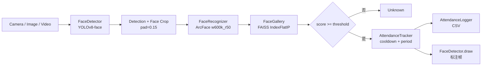

# 架构说明

核心 MVP 把「校园人脸识别考勤系统」中的业务无关部分剥离为一条单向流水线，
每一层只依赖上一层的数据结构，便于替换与测试。

## 1. 分层



| 层 | 模块 | 输入 → 输出 | 职责 |
|----|------|-------------|------|
| 检测层 | `detector.py` | `np.ndarray` → `List[Detection]`, `List[crop]` | 定位人脸、面积过滤、外扩裁剪、绘制 |
| 特征层 | `recognizer.py` | `crop` → `np.ndarray(512,)` | BGR→RGB、归一化、ONNX 推理、L2 归一化 |
| 检索层 | `gallery.py` | `feature` → `[(student_id, score)]` | 特征持久化、元数据、精确内积检索 |
| 决策层 | `pipeline.py` | `frame` → `vis_frame`, `events` | 阈值判定、冷却去重、时段状态、抓拍与落盘 |
| 业务层 | `attendance.py` | `student_id + now` → `AttendanceEvent` | 签到状态机，与识别解耦 |

## 2. 关键数据结构

```python
Detection(x1, y1, x2, y2, conf)          # 像素坐标、按面积降序
AttendanceEvent(student_id, name, class_name, status, period,
                similarity, timestamp, snapshot_path)
```

`FacePipeline.process_frame` / `process_image` 统一返回：

```python
{
  "vis_frame": np.ndarray,      # 带框、标签、时间戳的可视化结果
  "detections": List[Detection],
  "labels": List[str],          # 与 detections 对齐
  "events": List[AttendanceEvent],   # 本次新增签到（冷却中/陌生人不在其中）
  "face_count": int,
  "latency_ms": float,
  "throttled": bool,            # 帧率节流跳过时为 True
}
```

## 3. 时间与状态

- `process_frame` 的**节流**使用 `time.perf_counter()`（单调时钟），保证视频流畅；
- **业务时间**（时段、迟到、冷却、时间戳）使用可注入的 `now`，因此可以离线回放：

```python
from datetime import datetime
pipe.process_image(img, now=datetime(2026, 3, 19, 7, 50))  # 判定为 Late
```

## 4. 可扩展点

| 需求 | 改动位置 | 做法 |
|------|----------|------|
| 换检测器（RetinaFace/YOLOv5-face） | `detector.py` | 保持 `detect() -> List[Detection]` 契约 |
| 换识别模型（MobileFace/AdaFace） | `recognizer.py` | 只改 `preprocess` 与输出维度 |
| 加人脸对齐 | `detector.py` + `recognizer.py` | `Detection` 增加 5 点关键点，`preprocess` 做相似变换 |
| 换存储 | `attendance.py` | 实现同名 `append/read` 的 MySQL 版 `Logger` |
| 加 Web 接口 | 新增 `api/` | 调用 `process_frame`，MJPEG 推流即可 |
| 大规模检索 | `gallery.py` | `IndexFlatIP` → `IndexIVFFlat` / 向量数据库 |

## 5. 测试

`tests/test_smoke.py` 不依赖 pytest：

```bash
python tests/test_smoke.py
```

覆盖：特征库增删查与持久化、FAISS/NumPy 双后端、冷却与迟到判定、
检测 + 注册 + 端到端识别（模型缺失时自动跳过）。
